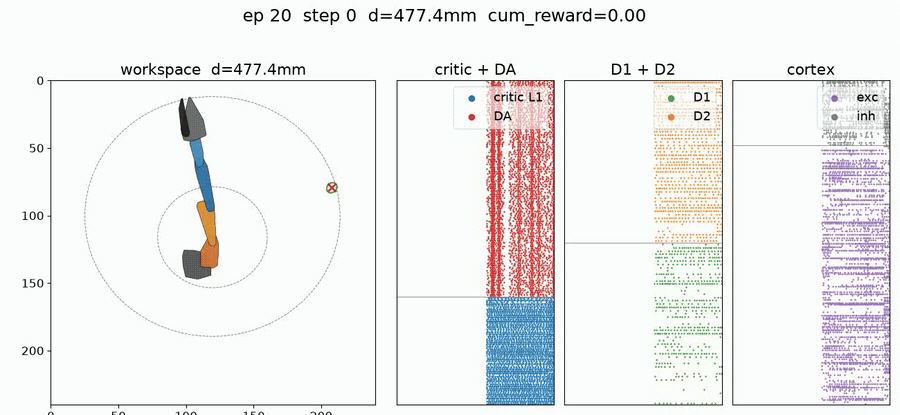

# dopamine-credit-assignment

A striatum-inspired spiking actor-critic with dopamine-modulated plasticity, studying what makes credit assignment work on CartPole and a 2-DOF reaching arm.

*Example rollout (frozen weights, greedy eval, genuine success): the 2-DOF arm (left) closes 477mm down to 11mm, alongside the critic/dopamine, D1/D2, and cortex spike rasters driving it.*

## Reproducing the paper's numbers

See [`experiments/stats/README.md`](experiments/stats/README.md) for how every p-value and figure in the paper is regenerated from `experiments/runs/`.

## Author

Borislav Markov
Institute of Information and Communication Technologies, Bulgarian Academy of Sciences, Sofia, Bulgaria
ORCID: [0009-0001-9785-367X](https://orcid.org/0009-0001-9785-367X)
